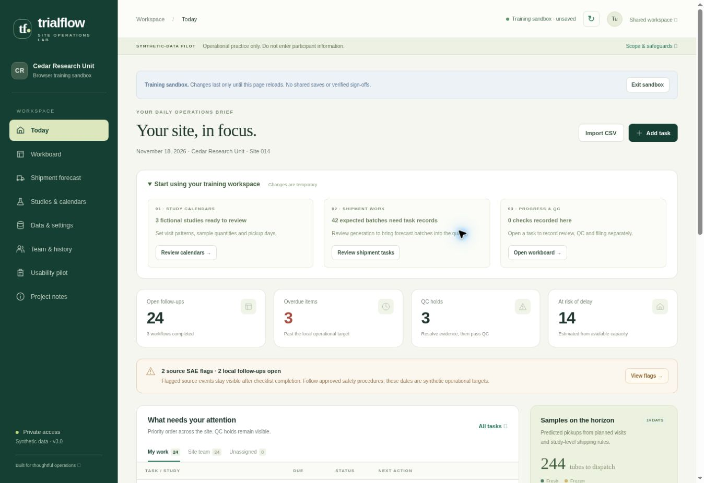

# Trialflow · Site Operations Lab

A clinical trial **site operations simulator** that brings scattered follow-ups into a single, explainable work queue. Built as a computational portfolio project using fictional studies and synthetic operational records.

**Synthetic data only.** This project is a pilot, not a validated clinical system. It does not interpret clinical results, submit safety reports or connect to a live EDC.



## The problem

Coordinators juggle visit windows, sample pickups, regulatory submissions, monitoring requests, data queries, report review and investigational-product accountability across multiple studies. Separate trackers make it hard to see what is overdue, blocked by QC, or likely to slip when workload changes.

Trialflow makes those dependencies visible while keeping investigator review, QC and filing as distinct human actions.

## Features

- **Today queue:** personal, team and unassigned work; overdue targets; QC holds; explainable operational-delay estimates.
- **Site workstreams:** fresh/frozen shipments, submissions, monitoring actions, queries, lab/EKG reports, accountability, visits, AEs, SAEs and deviations.
- **Ordered checks:** role-specific review, QC and filing; hold resolution does not pass QC; reopening invalidates downstream evidence.
- **Planning:** editable working days, holidays, timezone, visit patterns, tube assumptions, selected-weekday/fortnightly pickups and courier delay.
- **What-if simulation:** compare impact-and-urgency, deadline-first and shortest-first policies under different team capacity.
- **Shared pilot:** server-side role checks, versioned database saves, stale-write protection and timestamped actor/reason/before/after history.
- **Input and recovery:** task/study forms, validated CSV previews, duplicate protection, JSON/CSV exports and reviewed restore points.
- **Usability evaluation:** voluntary task timing, self-reported outcomes, observations and ease ratings for a future small tester study.

Source AE/SAE flags and local task completion are separate: completing a checklist never closes the source event.

## Run locally

Use Node.js **24** and npm. The checked-in lockfile fixes the dependency versions.

```bash
npm run install:ci
npm test
npm run dev
```

Open the local address printed by the server and choose **Explore training sandbox**. The sandbox uses bundled fixtures and browser memory. Its changes disappear on reload; it does not create verified sign-offs or write shared records.

```bash
npm run build
```

The original shared deployment depends on the managed hosting platform's verified identity headers and a D1 database. The additional Netlify adapter uses verified Netlify team login, a Function and conditional SQLite snapshot storage in Netlify Blobs. See [private Netlify setup](docs/NETLIFY.md). Local sandbox exploration does not verify either hosted sign-in flow.

## Computational approach

1. **State machines:** ordered checks determine the next allowed action and completion state. Server-side role/prerequisite checks protect each transition.
2. **Explainable prioritization:** bounded due-date urgency + operational impact + waiting age. Unblocked SAE follow-ups retain precedence under every policy.
3. **Capacity scheduling:** remaining effort is assigned sequentially across site working days; unresolved QC holds remain visible outside the capacity queue. This estimates operational delay, not clinical risk.
4. **Shipment forecasting:** planned visits × tubes per visit, dated visit overrides, opening frozen-inventory assumptions, pickup calendars and working-day delays. Generation deduplicates batches and preserves existing evidence.
5. **Consistency:** compare-and-swap workspace versions reject stale edits; changes and audit events commit together.

The model is deterministic. It uses no machine learning or LLM inference, and its scores are not calibrated probabilities.

## Stack and source map

| Component | Implementation |
|---|---|
| Interface | JavaScript ES modules, HTML, CSS |
| Shared rules | `public/domain.mjs` |
| Server | JavaScript/TypeScript; Cloudflare Worker or Netlify Function adapters |
| Persistence | D1, or bounded SQLite snapshots in Netlify Blobs; shared SQL schema |
| API and authorization | `lib/pilot-api.mjs` |
| Fictional fixtures | `lib/seed.mjs`, `lib/legacy/` |
| Tests | Node test runner and a real SQLite D1 adapter |

See [architecture, setup and model details](docs/ARCHITECTURE.md) and [validation evidence](VALIDATION.md).

## Validation and limits

**55 automated tests pass:** 21 original simulator regressions, 28 domain/API tests and 6 Netlify adapter tests. Coverage includes permissions, independent QC, source-flag separation, CSV validation and atomicity, concurrent updates, forecasting, restore behavior, pilot-session ownership, verified Netlify identity and conditional snapshot persistence. GitHub Actions installs, tests and builds both hosting targets.

Browser smoke tests used the clearly labelled training sandbox. Live owner authentication, real multi-user testing, mobile-device evaluation, formal clinical validation and an institutional security review remain outstanding. No human usability study has been conducted yet.

## Hosting configuration

For Netlify, follow [the private hosting guide](docs/NETLIFY.md) and use the committed `netlify.toml`. Connect this repository and keep production and previews private. A connected project's GitHub pushes can trigger deploys; privacy is an independent project setting. The new adapter starts a separate workspace and does not migrate saved data from the original deployment.

For the original managed Sites target, this repository deliberately omits the live Site identity. `.openai/hosting.json` contains `project_id: null` plus the required `DB` binding declaration. A new Sites deployment must set its own hosting identity and apply the schema-only migrations.

The original Sites runtime requires:

| Setting | Purpose |
|---|---|
| `DB` | D1 binding with the committed migrations applied |
| `SITE_OWNER_EMAIL` | Secret runtime setting identifying the approved initial owner |
| Verified platform identity | Trusted authenticated-user headers supplied by hosting |

Configure runtime values through the hosting environment. No credentials belong in this repository. Workspace membership and private Site audience are separate controls; configuring a member does not send an invitation or grant Site access.

## Responsible use

Do not enter participant names, identifiers, narratives or clinical results. The synthetic-data banner is a scope instruction, not a de-identification detector. The app does not diagnose, interpret lab/EKG findings, decide reportability or submit reports. Example dates are operational targets, not regulatory time limits.

A real EDC connector requires approved vendor access, study/site mappings, source timestamps, idempotency, failure handling and reconciliation testing. Same-database restore points are not offsite disaster recovery. No GCP, HIPAA, Part 11 or electronic-signature compliance claim is made.

## Project development

This project translates clinical coordination requirements into workflow models, scheduling rules and a usable prototype. It demonstrates state modeling, SQL persistence, authorization, validation, concurrency, simulation and usability-evaluation design. AI assistance was used for implementation and documentation; the project owner should review and understand the code and report that assistance accurately.

Third-party components retain their existing notices. No open-source license for the original project code is granted by this repository; it is intended to remain private unless the owner decides otherwise.
